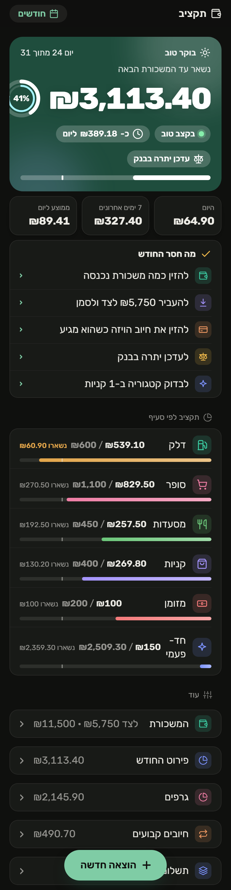

# Taktziv (תקציב)

A personal budget app for an iPhone, built around one problem: logging expenses by hand never lasts. Here, a purchase made with Apple Pay shows up in the budget on its own a second later, sorted into a category.

**Demo:** open the site without a key and it runs on made-up data stored in your browser. The interface is in Hebrew.



## How purchases get in

```
Apple Pay payment ──► iOS Shortcut (Wallet automation) ──POST /p──►  api/tx.js ──► Vercel Blob
Screenshot of the Cal app ──► "Share → Add to budget" Shortcut (Live Text) ──► lib/ocr.js ──┘
Typed in the app ──────────────────────────────────────────────────────────────────────────┘
```

1. **Apple Pay.** An iOS automation fires on every Wallet payment and sends the amount, merchant and card to `/p`. The server categorizes the merchant (Hebrew and English keyword lists, plus rules learned from the user's own corrections) and answers with a one-line confirmation the Shortcut shows as a notification.
2. **Screenshots.** Not every purchase goes through Apple Pay. A screenshot of the card company's transaction list goes through Live Text, and `lib/ocr.js` rebuilds the rows from that text. Live Text is messy: it reads the ₪ sign as letters or as an extra digit, drops decimal points, and changes the order of the columns. The parser handles each of these, and anything already in the app is skipped (`newRows`).
3. **By hand,** for cash.

## Things I cared about

- **Never lose a purchase.** Before anything else, an Apple Pay purchase is written to its own small file in an inbox. If the main write fails or two writes race, the next time the app opens `recover()` puts the purchase back. Settings and purchases are stored in separate files, so saving a setting can never overwrite an expense.
- **A read error is not an empty file.** If storage can't be read, the request fails instead of carrying on with no data, because the next save would wipe everything.
- **Access.** A long key in the link, plus an optional PIN that is asked for once per phone. A wrong PIN costs a one-second delay, so guessing it takes days. The Shortcut can use a separate short key that can only *add* an expense and gets no data back.
- **Budget by salary cycle, not calendar month.** A cycle runs from payday to the day before the next one, with recurring charges placed on their real dates.

## Stack

Vanilla JavaScript (no framework, no build step), Vercel serverless functions, Vercel Blob for storage, iOS Shortcuts. Tests use Node's built-in test runner.

```
api/state.js   GET budget + purchases, PUT settings
api/tx.js      add / recategorize / delete a purchase; screenshot import
lib/store.js   storage, categorization, auth
lib/ocr.js     Live Text → purchases
public/        the app (index.html, app.js) and demo.js
test/          parser and categorization tests
```

## Running it

```bash
npm install
npm test
npx vercel dev        # needs APP_KEY and BLOB_READ_WRITE_TOKEN; optional APP_PIN, PAY_KEY
```

Opening `public/index.html` through any static server, without `?k=`, runs the demo.
